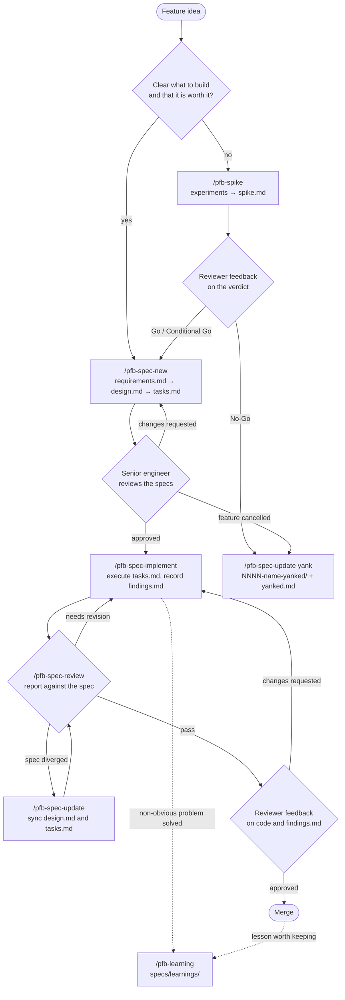

# PeopleForBikes AI Toolkit (experimental)

The AI resources PeopleForBikes uses across its projects, shared with the team
and with anyone who finds them useful:

| Resource                 | What it is                                                        | Where              |
| :----------------------- | :---------------------------------------------------------------- | :----------------- |
| **Agent skills**         | The `pfb-sdld` Claude Code plugin: specification-driven workflow  | `plugins/`         |
| **Claude Code settings** | Shared permission rules, merged into each project's settings file | `claude/settings/` |
| **nono profiles**        | Sandbox profile used to run AI agents across our projects         | `nono/profiles/`   |

Everything is released under the [MIT license](LICENSE).

> [!NOTE]
>
> This folder is an experiment hosted in the brokenspoke-analyzer repository.
> Once stable, it is meant to become its own public repository; see
> [Releasing to the organization](#releasing-to-the-organization).

## Agent skills: the `pfb-sdld` plugin

`pfb-sdld` packages our Specification-Driven LLM Development (SDLD) workflow.

| Skill                | Purpose                                                                                                    |
| :------------------- | :--------------------------------------------------------------------------------------------------------- |
| `pfb-spike`          | Research a possible feature with real experiments; records evidence and a Go / No-Go verdict in `spike.md` |
| `pfb-spec-new`       | Interview-style conversation resulting in `requirements.md`, `design.md`, `tasks.md`                       |
| `pfb-spec-implement` | Execute `tasks.md` in order, ticking tasks, running the project's checks, recording `findings.md`          |
| `pfb-spec-review`    | Strict review of an implementation against its spec (report only)                                          |
| `pfb-spec-update`    | Sync a spec with what was built, or yank a cancelled feature or No-Go spike                                |
| `pfb-learning`       | Capture a solved problem or team decision in `specs/learnings/`                                            |

`pfb-spec-implement` only runs when invoked explicitly. The other skills can
also be picked up automatically when a request matches their description.

`pfb-spec-review` always runs in a fresh context (`context: fork` with
`agent: general-purpose` in its frontmatter): Claude Code starts a separate
subagent that sees none of the current conversation, only the repository, the
spec and the arguments. This keeps the reviewer from inheriting the reasoning of
the session that wrote the code. Because the subagent cannot ask questions
mid-review, pass the spec folder explicitly
(`/pfb-spec-review specs/NNNN-feature-name`); if it is missing and cannot be
inferred from the branch, the review stops and lists the candidates. The report
comes back to the main session when the subagent finishes. Other agents, such as
Copilot, may ignore these frontmatter fields and run the review inline; start a
new session before reviewing there.

### Conventions the skills rely on

- Feature specs live in `specs/NNNN-feature-name/` (four-digit, sequential),
  each with `requirements.md`, `design.md` and `tasks.md`. A folder may also
  hold:
  - `spike.md`: the research done before specifying the feature (`pfb-spike`),
    ending in a Go, Conditional Go or No-Go verdict;
  - `findings.md`: everything non-obvious learned while implementing it
    (`pfb-spec-implement`), reviewed by a teammate at the end.
- Every spike is numbered like a feature. A Go spike's folder becomes the
  feature's folder; `pfb-spec-new` adds the three documents next to `spike.md`.
- Requirements use user stories with EARS acceptance criteria.
- Cancelled features are renamed to `specs/NNNN-feature-name-yanked/` and gain a
  `yanked.md` explaining why. Their number stays reserved. A No-Go spike is
  yanked the same way and keeps only `spike.md` and `yanked.md`, so teammates
  know why the team stopped and do not repeat the investigation.
- Learnings live in `specs/learnings/<category>/<slug>.md`.
- `specs/README.md` is never modified by the skills.
- `docs/` is reserved for the published documentation website. No skill writes
  planning material there.
- Each repository's `CLAUDE.md` / `AGENTS.md` documents its stack and its
  quality command (e.g. `just ci`), which the skills read instead of assuming.
- Repo templates in `specs/xxxx-feature-templates/` override the ones bundled
  with `pfb-spec-new`.

### Typical flow



## Claude Code settings

Claude Code plugins cannot carry permission rules, and without an organization
plan there are no managed settings to push them. Shared rules therefore live in
each project's committed `.claude/settings.json`, which applies to everyone who
opens the project. `claude/settings/base.json` holds the rules every
PeopleForBikes project starts from:

- **allow**: read-only `git` and `gh` commands, and `nono why`;
- **ask**: anything that changes a repository or GitHub (`git commit`,
  `git push`, `gh pr create`, …);
- **deny**: reading `.env` files and `secrets/`, `curl`, `wget`, `sudo`.

A deny rule in a project's committed settings applies even if a contributor
allows the same thing in their personal settings; allow rules only save prompts.

Merge the base into a project with:

```console
just sync-claude-settings path/to/project
```

The merge only adds: project-specific rules (e.g. `Bash(uv run pytest*)` or
`Bash(cargo test*)`) and other settings are kept. Lists are combined, objects
merged, and the project's value wins for anything else. Running it again is
harmless. To keep projects in line, run the check in each project's CI; it exits
with status 1 and lists what is missing:

```console
just check-claude-settings path/to/project
```

Personal preferences (model, theme, telemetry, …) belong in each contributor's
own `~/.claude/settings.json` or the project's `.claude/settings.local.json`,
not in the base.

## nono profiles

[nono](https://nono.sh/) runs AI agents in an OS-enforced sandbox.
`nono/profiles/pfb-claude.json` is a single profile meant for all our projects
rather than one per project: most of them need the same access (Overpass and
Geofabrik downloads, services on port 3000, PostgreSQL on port 5432), and
per-project profiles would add overhead for little security gain.

It extends the `nolabs-ai/claude` pack and adds, among others, read access to
the GitHub CLI login (`~/.config/gh`), `/Library/Keychains` and `~/.docker`.
Review [SECURITY.md](SECURITY.md) for what it grants before installing.

Install and use it:

```console
nono pull nolabs-ai/claude
just install-nono-profiles
nono run --profile pfb-claude claude
```

`just install-nono-profiles` copies the profiles into
`$XDG_CONFIG_HOME/nono/profiles/` (`~/.config/nono/profiles/` by default). It
refuses to overwrite a local copy that differs and shows the difference; run
`just install-nono-profiles force` to overwrite it. Inspect the fully resolved
policy with `nono profile show pfb-claude`.

## Trying it out

While the toolkit lives in brokenspoke-analyzer, run the `just` recipes from
this folder (`cd ai-toolkit`), and the commands below from the repository root.

### Claude Code: load the skills from the working tree

Start Claude Code with the plugin loaded directly from this folder. Edits to the
skills are picked up the next time you start a session; nothing is installed.

```console
claude --plugin-dir ./ai-toolkit/plugins/pfb-sdld
```

Then, inside the session:

```console
/pfb-spike is downloading OSM data per city faster than clipping the region?
/pfb-spec-new add a --version flag to the CLI
/pfb-spec-implement specs/0006-version-flag
/pfb-spec-review specs/0006-version-flag
/pfb-spec-update specs/0006-version-flag yank superseded by #1234
/pfb-learning the SRID mismatch we just fixed in the stress SQL
```

The fully qualified names (`/pfb-sdld:pfb-spec-new`, …) also work and are what
`/help` lists.

### Claude Code: install from the local marketplace

This copies the plugin into Claude Code's plugin cache, so edits to this folder
require an update to be picked up.

```console
claude plugin marketplace add ./ai-toolkit
claude plugin install pfb-sdld@pfb-plugins
```

After changing a skill:

```console
claude plugin marketplace update pfb-plugins
claude plugin update pfb-sdld@pfb-plugins
```

To remove it:

```console
claude plugin uninstall pfb-sdld@pfb-plugins
claude plugin marketplace remove pfb-plugins
```

### GitHub Copilot CLI

Copilot CLI reads Claude-compatible plugin manifests. This has not been tested
with these skills yet; please report how it goes.

```console
copilot plugin marketplace add ./ai-toolkit
copilot plugin install pfb-sdld@pfb-plugins
```

### Validating changes

From this folder:

```console
just ci
```

It lints the Markdown, validates the plugin marketplace, the plugins and the
nono profiles, and runs the tests of the helper scripts. To see the loaded
skills and their token cost:

```console
claude --plugin-dir ./plugins/pfb-sdld plugin details pfb-sdld
```

## Layout

```text
ai-toolkit/
├── .claude-plugin/marketplace.json   # marketplace "pfb-plugins"
├── .github/workflows/ci.yaml         # runs `just ci`
├── plugins/pfb-sdld/
│   ├── .claude-plugin/plugin.json
│   └── skills/
│       ├── pfb-spike/                # SKILL.md + assets/spike-template.md
│       ├── pfb-spec-new/             # SKILL.md + assets/ (spec templates)
│       ├── pfb-spec-implement/       # SKILL.md + assets/findings-template.md
│       ├── pfb-spec-review/
│       ├── pfb-spec-update/
│       └── pfb-learning/             # SKILL.md + assets/learning-template.md
├── claude/settings/base.json         # shared permission rules
├── nono/profiles/pfb-claude.json     # organization-wide sandbox profile
├── scripts/                          # settings merge script and its tests
├── justfile
├── CONTRIBUTING.md · SECURITY.md · code-of-conduct.md · LICENSE
```

Each skill is a `SKILL.md` file: YAML frontmatter (`name`, `description`,
`argument-hint`) followed by the instructions the agent follows. The
`description` decides when the agent picks the skill on its own, so keep it
specific.

## Releasing to the organization

Once the team is happy with the toolkit, move it out of brokenspoke-analyzer
into a dedicated public repository. The steps below use
`PeopleForBikes/ai-toolkit` as the repository name.

### 1. Create the dedicated repository, keeping history

Create an empty public `PeopleForBikes/ai-toolkit` repository on GitHub, then
extract this folder with its commit history. `git subtree split` rewrites the
history so `ai-toolkit/` becomes the repository root, which is where Claude Code
looks for `.claude-plugin/marketplace.json` and GitHub looks for
`.github/workflows/`.

```console
git subtree split --prefix=ai-toolkit -b ai-toolkit-export
git push git@github.com:PeopleForBikes/ai-toolkit.git ai-toolkit-export:main
git branch -D ai-toolkit-export
```

In the repository settings, enable **Private vulnerability reporting** (used by
[SECURITY.md](SECURITY.md)) and GitHub Actions.

### 2. Prepare the first release

In the new repository:

- Remove the "experimental" note at the top of this README, and update the
  install commands to use `PeopleForBikes/ai-toolkit` instead of `./ai-toolkit`.
- Set `version` in `plugins/pfb-sdld/.claude-plugin/plugin.json` (e.g. `1.0.0`).
  Installed copies only pick up changes when this version changes, so bump it
  for every release.
- Add the marketplace to `claude/settings/base.json`, so syncing a project also
  offers the skills to everyone who opens it:

  ```json
  {
    "extraKnownMarketplaces": {
      "pfb-plugins": {
        "source": { "source": "github", "repo": "PeopleForBikes/ai-toolkit" }
      }
    },
    "enabledPlugins": { "pfb-sdld@pfb-plugins": true }
  }
  ```

- Make sure CI passes, then tag the release. `claude plugin tag` checks that
  `plugin.json` and the marketplace entry agree, then creates a
  `pfb-sdld--v<version>` tag:

  ```console
  claude plugin tag ./plugins/pfb-sdld --push
  ```

### 3. Adopt the toolkit in each project

- Sync the shared settings into the project and commit the result:
  `just sync-claude-settings path/to/project`. Add the project's own rules to
  its `.claude/settings.json`.
- Add `just check-claude-settings` (or the equivalent script call) to the
  project's CI.
- Make sure the project has a `specs/` folder. Adding
  `specs/xxxx-feature-templates/` is optional: the templates bundled with
  `pfb-spec-new` are used otherwise.
- Make sure the project's `CLAUDE.md` / `AGENTS.md` names its quality command
  (e.g. `just ci`, `cargo test`, `npm test`) and states that `docs/` is the
  published documentation website and must not receive planning material.
- Optionally mention `specs/learnings/` in `CLAUDE.md` / `AGENTS.md` up front;
  otherwise `pfb-learning` offers to add the line the first time it runs.

Contributors install the nono profile once per machine (see
[nono profiles](#nono-profiles)). Copilot CLI users install the plugin once per
machine:

```console
copilot plugin marketplace add PeopleForBikes/ai-toolkit
copilot plugin install pfb-sdld@pfb-plugins
```

### 4. Clean up brokenspoke-analyzer

Remove this `ai-toolkit/` folder from brokenspoke-analyzer and adopt the toolkit
there like any other project (step 3), so there is a single source of truth.

### 5. Link it from the documentation site

Add a page to the general documentation site describing the toolkit and linking
to the repository. Keep the files themselves in the repository, where they are
versioned, validated and installable.

### Shipping updates

1. Change the toolkit through pull requests on `PeopleForBikes/ai-toolkit`.
2. For the skills, bump `version` in `plugin.json` and tag the release (step 2).
3. Contributors update with:

   ```console
   claude plugin marketplace update pfb-plugins
   claude plugin update pfb-sdld@pfb-plugins
   just install-nono-profiles force
   ```

   Projects pick up new shared permission rules the next time
   `just sync-claude-settings` runs; their CI check flags when that is due.

## Feedback

While experimenting, note where a skill asked too much or too little, wrote
something it should not have, or missed a project convention, and adjust the
corresponding `SKILL.md`.
