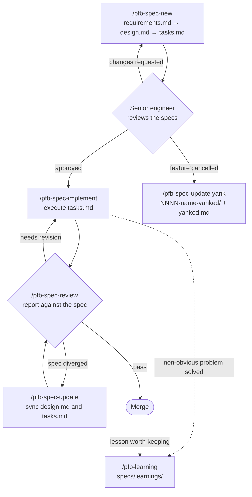

# PeopleForBikes AI Skills (experimental)

Shared AI-assisted development skills for PeopleForBikes projects, packaged as a
Claude Code plugin marketplace.

> [!NOTE]
>
> This folder is an experiment hosted in the brokenspoke-analyzer repository.
> Once the skills are stable, it is meant to move to its own PeopleForBikes
> repository so every project can install it.

## Plugins

### `pfb-sdld`: Specification-Driven LLM Development

| Skill                | Purpose                                                                  |
| :------------------- | :----------------------------------------------------------------------- |
| `pfb-spec-new`       | Question-first drafting of `requirements.md`, `design.md`, `tasks.md`    |
| `pfb-spec-implement` | Execute `tasks.md` in order, ticking tasks, running the project's checks |
| `pfb-spec-review`    | Strict review of an implementation against its spec (report only)        |
| `pfb-spec-update`    | Sync a spec with what was built, or yank a cancelled feature             |
| `pfb-learning`       | Capture a solved problem or team decision in `specs/learnings/`          |

`pfb-spec-implement` only runs when invoked explicitly. The other skills can
also be picked up automatically when a request matches their description.

`pfb-spec-review` always runs in a fresh context (`context: fork` with
`agent: general-purpose` in its frontmatter): Claude Code starts a separate
subagent that sees none of the current conversation, only the repository, the
spec and the arguments. This keeps the reviewer from inheriting the reasoning of
the session that wrote the code. Because the subagent cannot ask questions
mid-review, pass the spec folder explicitly
(`/pfb-spec-review specs/NNNN-feature-name`); if it is missing and cannot be
inferred from the branch, the review stops and lists the candidates. The report
comes back to the main session when the subagent finishes. Other agents, such as
Copilot, may ignore these frontmatter fields and run the review inline; start a
new session before reviewing there.

#### Conventions the skills rely on

- Feature specs live in `specs/NNNN-feature-name/` (four-digit, sequential),
  each with exactly `requirements.md`, `design.md` and `tasks.md`.
- Requirements use user stories with EARS acceptance criteria.
- Cancelled features are renamed to `specs/NNNN-feature-name-yanked/` and gain a
  `yanked.md` explaining why. Their number stays reserved.
- Learnings live in `specs/learnings/<category>/<slug>.md`.
- `specs/README.md` is never modified by the skills.
- `docs/` is reserved for the published documentation website. No skill writes
  planning material there.
- Each repository's `CLAUDE.md` / `AGENTS.md` documents its stack and its
  quality command (e.g. `just ci`), which the skills read instead of assuming.
- Repo templates in `specs/xxxx-feature-templates/` override the ones bundled
  with `pfb-spec-new`.

#### Typical flow



## Trying the skills

All commands below are run from the repository root.

### Claude Code: load from the working tree (recommended while iterating)

Start Claude Code with the plugin loaded directly from this folder. Edits to the
skills are picked up the next time you start a session; nothing is installed.

```console
claude --plugin-dir ./pfb-skills/plugins/pfb-sdld
```

Then, inside the session:

```console
/pfb-spec-new add a --version flag to the CLI
/pfb-spec-implement specs/0006-version-flag
/pfb-spec-review specs/0006-version-flag
/pfb-spec-update specs/0006-version-flag yank superseded by #1234
/pfb-learning the SRID mismatch we just fixed in the stress SQL
```

The fully qualified names (`/pfb-sdld:pfb-spec-new`, …) also work and are what
`/help` lists.

### Claude Code: install from the local marketplace

This copies the plugin into Claude Code's plugin cache, so edits to this folder
require an update to be picked up.

```console
claude plugin marketplace add ./pfb-skills
claude plugin install pfb-sdld@pfb-plugins
```

After changing a skill:

```console
claude plugin marketplace update pfb-plugins
claude plugin update pfb-sdld@pfb-plugins
```

To remove it:

```console
claude plugin uninstall pfb-sdld@pfb-plugins
claude plugin marketplace remove pfb-plugins
```

### GitHub Copilot CLI

Copilot CLI reads Claude-compatible plugin manifests. This has not been tested
with these skills yet; please report how it goes.

```console
copilot plugin marketplace add ./pfb-skills
copilot plugin install pfb-sdld@pfb-plugins
```

### Validating changes

```console
claude plugin validate ./pfb-skills
claude plugin validate ./pfb-skills/plugins/pfb-sdld
claude --plugin-dir ./pfb-skills/plugins/pfb-sdld plugin details pfb-sdld
```

The last command lists the loaded skills and their token cost.

## Layout

```text
pfb-skills/
├── .claude-plugin/marketplace.json   # marketplace "pfb-plugins"
└── plugins/pfb-sdld/
    ├── .claude-plugin/plugin.json
    └── skills/
        ├── pfb-spec-new/              # SKILL.md + assets/ (spec templates)
        ├── pfb-spec-implement/
        ├── pfb-spec-review/
        ├── pfb-spec-update/
        └── pfb-learning/              # SKILL.md + assets/learning-template.md
```

Each skill is a `SKILL.md` file: YAML frontmatter (`name`, `description`,
`argument-hint`) followed by the instructions the agent follows. The
`description` decides when the agent picks the skill on its own, so keep it
specific.

## Releasing to the organization

Once the team is happy with the skills, move them out of brokenspoke-analyzer
into a dedicated repository so every PeopleForBikes project can install them.
The steps below use `PeopleForBikes/pfb-ai-skills` as an example name.

### 1. Create the dedicated repository, keeping history

Create an empty `PeopleForBikes/pfb-ai-skills` repository on GitHub, then
extract this folder with its commit history. `git subtree split` rewrites the
history so `pfb-skills/` becomes the repository root, which is where Claude Code
looks for `.claude-plugin/marketplace.json`.

```console
git subtree split --prefix=pfb-skills -b pfb-skills-export
git push git@github.com:PeopleForBikes/pfb-ai-skills.git pfb-skills-export:main
git branch -D pfb-skills-export
```

### 2. Prepare the first release

In the new repository:

- Remove the "experimental" note at the top of this README and update the
  install commands below to use `PeopleForBikes/pfb-ai-skills` instead of
  `./pfb-skills`.
- Set `version` in `plugins/pfb-sdld/.claude-plugin/plugin.json` (e.g. `1.0.0`).
  Installed copies only pick up changes when this version changes, so bump it
  for every release.
- Add a CI workflow that runs, on every pull request:

  ```console
  claude plugin validate .
  claude plugin validate ./plugins/pfb-sdld
  npx --yes markdownlint-cli2 "**/*.md"
  ```

- Tag the release. `claude plugin tag` checks that `plugin.json` and the
  marketplace entry agree, then creates a `pfb-sdld--v<version>` tag:

  ```console
  claude plugin tag ./plugins/pfb-sdld --push
  ```

### 3. Enable the plugin in each project

In each project that should use the skills, commit a `.claude/settings.json` (or
merge into the existing one) so every team member is offered the plugin when
they trust the folder:

```json
{
  "extraKnownMarketplaces": {
    "pfb-plugins": {
      "source": { "source": "github", "repo": "PeopleForBikes/pfb-ai-skills" }
    }
  },
  "enabledPlugins": { "pfb-sdld@pfb-plugins": true }
}
```

The same result can be obtained from the command line:

```console
claude plugin marketplace add PeopleForBikes/pfb-ai-skills --scope project
claude plugin install pfb-sdld@pfb-plugins --scope project
```

If the repository is private, team members need read access to it and working
GitHub credentials (for example `gh auth login`).

Copilot CLI users install it once per machine:

```console
copilot plugin marketplace add PeopleForBikes/pfb-ai-skills
copilot plugin install pfb-sdld@pfb-plugins
```

### 4. Prepare each project for the skills

- Make sure the project has a `specs/` folder. Adding
  `specs/xxxx-feature-templates/` is optional: the templates bundled with
  `pfb-spec-new` are used otherwise.
- Make sure the project's `CLAUDE.md` / `AGENTS.md` names its quality command
  (e.g. `just ci`, `cargo test`, `npm test`) and states that `docs/` is the
  published documentation website and must not receive planning material.
- Optionally mention `specs/learnings/` in `CLAUDE.md` / `AGENTS.md` up front;
  otherwise `pfb-learning` offers to add the line the first time it runs.

### 5. Clean up brokenspoke-analyzer

Remove this `pfb-skills/` folder from brokenspoke-analyzer and enable the plugin
there like any other project (step 3), so there is a single source of truth.

### Shipping updates

1. Change the skills through pull requests on `PeopleForBikes/pfb-ai-skills`.
2. Bump `version` in `plugin.json` and tag the release (step 2).
3. Team members get the new version with:

   ```console
   claude plugin marketplace update pfb-plugins
   claude plugin update pfb-sdld@pfb-plugins
   ```

## Feedback

While experimenting, note where a skill asked too much or too little, wrote
something it should not have, or missed a project convention, and adjust the
corresponding `SKILL.md`.
