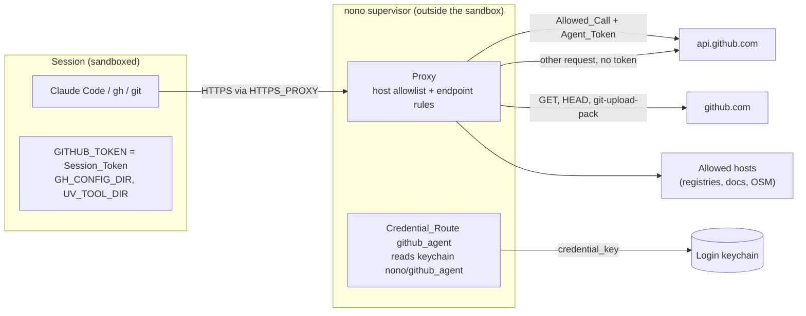

# Design Document: Review of the pfb-claude nono profile

## Overview

The feature replaces `nono/profiles/pfb-claude.json` with version 2.0.0, adds a
standard-library unit test that checks the profile's security properties and its
documentation in `SECURITY.md`, and updates `SECURITY.md`, `README.md` and
`CHANGELOG.md`. No script, recipe or CI workflow changes: `just validate`
already runs `nono profile validate` on every profile, and `just test` already
discovers every `scripts/test_*.py`. A `justfile` check warning at launch when
the agent token is missing was designed, implemented, then dropped at the
maintainer's request: it worked on macOS only and added little over the agent's
own warning (component 4).

The profile keeps extending `nolabs-ai/claude` and follows the spike's
recommendation (`spike.md` §6): the cleanup of §5.1, the hosts of §5.3, a nono
credential route that injects a classic agent token from the keychain (§5.9,
§5.10, tested on the command line in §5.11), endpoint rules on `github.com` that
refuse pushes (§5.6), the VS Code exclusion and the `.git/hooks` deny (§5.4),
and `UV_TOOL_DIR` (§5.5). One element is new since the spike: gh's configuration
is moved to an empty directory in the sandbox, so that gh never falls back to
the developer's own login (Requirement 3.5) and the `~/.config/gh` read grant
can go. It is verified in the live session.

The design was validated before writing: the profile below, saved to a scratch
file, passes `nono profile validate` (nono 0.82.0, "All 27 group references
valid").

## Architecture



- The agent sees only the Session_Token. For a request to `api.github.com` that
  matches the route's `endpoint_rules`, the proxy replaces it with the
  Agent_Token; any other request reaches GitHub without a valid token and is
  refused there with `401 Bad credentials` (observed in `spike.md` §5.11: the
  rules decide which requests carry the token, they do not block requests).
- `github.com` traffic goes through the proxy's endpoint rules, which refuse
  everything except reads and Git fetches.
- Everything else is the proxy's host allowlist, unchanged in mechanism.

## Components and Interfaces

### 1. `nono/profiles/pfb-claude.json` (rewritten)

The complete file:

```json
{
  "extends": ["nolabs-ai/claude"],
  "meta": {
    "name": "pfb-claude",
    "version": "2.0.0",
    "description": "PeopleForBikes agents: org tools, dedicated GitHub token"
  },
  "groups": {
    "include": ["mise_manager"],
    "exclude": ["vscode_linux", "vscode_macos"]
  },
  "filesystem": {
    "allow": ["~/.local/state/mise", "~/.npm"],
    "write": ["~/.cargo/git", "~/.cargo/registry"],
    "deny": ["$WORKDIR/.git/hooks"],
    "suppress_save_prompt": ["… unchanged from version 1.0.0 …"]
  },
  "environment": {
    "deny_vars": [
      "GH_ENTERPRISE_TOKEN",
      "GH_TOKEN",
      "GITHUB_ENTERPRISE_TOKEN",
      "GITHUB_TOKEN"
    ],
    "set_vars": {
      "GH_CONFIG_DIR": "$HOME/.cache/nono/gh",
      "UV_TOOL_DIR": "$HOME/.cache/uv/tools"
    }
  },
  "network": {
    "block": false,
    "allow_http2": true,
    "allow_domain": [
      "127.0.0.1",
      "api.anthropic.com",
      "api.github.com",
      "code.claude.com",
      "codeload.github.com",
      "crates.io",
      "doc.rust-lang.org",
      "docs.github.com",
      "docs.rs",
      "download.geofabrik.de",
      "downloads.claude.ai",
      "files.pythonhosted.org",
      {
        "domain": "github.com",
        "endpoints": [
          { "method": "GET", "path": "/**" },
          { "method": "HEAD", "path": "/**" },
          { "method": "POST", "path": "/*/*/git-upload-pack" }
        ]
      },
      "hurl.dev",
      "index.crates.io",
      "localhost",
      "mcp-proxy.anthropic.com",
      "mise.jdx.dev",
      "nono.sh",
      "objects.githubusercontent.com",
      "overpass-api.de",
      "overpass.kumi.systems",
      "overpass.openstreetmap.fr",
      "platform.claude.com",
      "pypi.org",
      "raw.githubusercontent.com",
      "registry.npmjs.org",
      "release-assets.githubusercontent.com",
      "results-receiver.actions.githubusercontent.com",
      "static.crates.io",
      "statsig.anthropic.com"
    ],
    "credentials": ["github_agent"],
    "custom_credentials": {
      "github_agent": {
        "upstream": "https://api.github.com",
        "credential_key": "github_agent",
        "env_var": "GITHUB_TOKEN",
        "credential_format": "token {}",
        "endpoint_rules": [
          { "method": "GET", "path": "/**" },
          { "method": "POST", "path": "/graphql" },
          { "method": "POST", "path": "/repos/*/*/issues" },
          { "method": "POST", "path": "/repos/*/*/issues/*/comments" },
          { "method": "POST", "path": "/repos/*/*/pulls" },
          { "method": "POST", "path": "/repos/*/*/pulls/*/comments" },
          { "method": "POST", "path": "/repos/*/*/pulls/*/reviews" }
        ]
      }
    },
    "open_port": [3000, 5432]
  }
}
```

Decisions, by requirement:

- **R1**: `meta.name` was `claude`. The `mise_manager` built-in group grants
  read access to `/etc/mise`, `~/.local/bin/mise`, `~/.config/mise`,
  `~/.local/share/mise` and `~/.tool-versions`, replacing the hand-written mise
  reads of the installed copies; only the state directory stays explicit.
  `/Library/Keychains` and `~/.docker` are dropped (denied by the base, so never
  effective), and so is `~/Library/Caches/brokenspoke-analyzer` (already covered
  by the base's `user_caches_macos` group).
- **R2**: `allow_domain` is sorted by host name with plain code-point order, the
  `github.com` object in its place. `api.github.com` stays a plain entry, as in
  the tested command line (§5.11): requests outside the route's rules must still
  reach GitHub so that it refuses them, rather than failing in an unexplained
  way inside the proxy.
- **R3**: the route is a profile-defined `custom_credentials` entry, named
  `github_agent` so it does not shadow nono's built-in `github` route (which
  reads `env://GITHUB_TOKEN`). A bare `credential_key` reads the keychain
  service `nono`, account `github_agent`, from the supervisor. `deny_vars`
  removes every Developer_Token variable the shell may pass; nono's guide states
  that injected credentials bypass `allow_vars`, and the live session checks
  that the Session_Token in `GITHUB_TOKEN` survives the deny as well.
  `GH_CONFIG_DIR` points gh at an empty, sandbox-writable directory: gh then has
  no saved login to fall back on and uses `GITHUB_TOKEN` alone, and the
  `~/.config/gh` read grant is removed.
- **R4**: endpoint rules on `github.com` allow only `GET`, `HEAD` and
  `POST /<owner>/<repo>/git-upload-pack` (`*` matches one path segment, so
  `bna-api.git` matches). `git-receive-pack`, the push, matches no rule.
- **R5**: `vscode_linux` is excluded with `vscode_macos`, since the base
  includes both, each on its platform. `$WORKDIR/.git/hooks` is denied; it is
  absolute after expansion, and git reads it on every commit, so the live
  session checks that commits still work.
- **R6**: `UV_TOOL_DIR` points to the cache, which the base grants for writing
  on macOS.

### 2. `scripts/test_nono_profiles.py` (new)

A `unittest` module with no script of its own, in the style of
`scripts/test_sync_claude_settings.py` (standard library only, docstrings on the
class and each test). It locates the repository from its own path
(`Path(__file__).resolve().parent.parent`), loads
`nono/profiles/pfb-claude.json` with `json`, and reads `SECURITY.md` as text.

One test method per property:

| Test                                     | Property (requirement)                                                                                                                                                                                                                                            |
| ---------------------------------------- | ----------------------------------------------------------------------------------------------------------------------------------------------------------------------------------------------------------------------------------------------------------------- |
| `test_identity`                          | `meta.name` is `pfb-claude`, `extends` is `nolabs-ai/claude` (1.1, 1.2)                                                                                                                                                                                           |
| `test_no_wildcard_hosts`                 | no host in `allow_domain` contains `*` (2.2, 8.2)                                                                                                                                                                                                                 |
| `test_hosts_sorted`                      | host names, with the `github.com` object's `domain`, are in sorted order and unique (2.6, 8.8)                                                                                                                                                                    |
| `test_github_web_allows_reads_and_fetch` | the `github.com` rules are exactly `GET /**`, `HEAD /**` and `POST /*/*/git-upload-pack` (4.1, 8.3)                                                                                                                                                               |
| `test_agent_route`                       | `credentials` is exactly `["github_agent"]` and `custom_credentials` holds only that route; its `credential_key` is `github_agent`, its upstream `https://api.github.com`, its rules exactly `GET /**` and the six Allowed_Call `POST` paths (3.1, 3.3, 3.4, 8.4) |
| `test_developer_tokens_removed`          | `deny_vars` contains the four Developer_Token variables, and `GH_CONFIG_DIR` is `$HOME/.cache/nono/gh` (3.1, 3.5, 8.5)                                                                                                                                            |
| `test_no_dead_or_open_paths`             | no grant on, inside or above `/Library/Keychains`, `~/.docker` or `~/.config/gh`, after spelling `$HOME` as `~` and dropping trailing slashes; `$WORKDIR/.git/hooks` denied; both VS Code groups excluded (1.3, 5.1, 5.2, 8.6)                                    |
| `test_hosts_documented`                  | every allowed host appears in `SECURITY.md` as a code span, `` `host` `` (7.1, 8.7)                                                                                                                                                                               |

"Exactly" compares sets of `(method, path)` pairs, so reordering rules passes
and any addition fails: widening a rule then needs a deliberate change to the
test, reviewed as security-sensitive. The path helpers (`normalize_path`,
`overlaps`) carry doctests, which the module's `load_tests` adds to unittest
discovery, so `just test` runs them.

### 3. `SECURITY.md`

The `pfb-claude` bullet of "What the shared configuration grants" becomes a
subsection, "The `pfb-claude` nono profile", with:

- the extension of `nolabs-ai/claude` and what the base already grants
  (summarised, pointing to `nono profile show`);
- a table of every allowed host, grouped (Claude Code, GitHub, Rust, npm,
  Python, documentation, OpenStreetMap, local), each with its reason, every host
  in a code span (Requirement 8.7 relies on it);
- the `github.com` rules and why (no push over HTTPS);
- paths added and removed, ports, `deny_vars`, `set_vars`;
- the agent token route, its Allowed_Calls, and the behavior of other requests;
- the accepted gaps: GraphQL mutations carry the Agent_Token; the Agent_Token
  (and anything else stored through `security`) is readable in the login
  keychain because `nolabs-ai/claude` grants it; not verified on Linux;
  `.git/config` and `~/.claude` stay writable.

### 4. `README.md`

- "nono profiles" section: replace the sentence on `~/.config/gh`,
  `/Library/Keychains` and `~/.docker` with a short summary pointing to
  `SECURITY.md`, and add "The agent's GitHub token": create a classic token with
  `public_repo` and `read:org` and an expiry (90 days suggested), store it with
  `security add-generic-password -s nono -a github_agent -w`, reinstall the
  profile, restart sessions; without the token, sessions start and gh is not
  logged in.
- "Adopting the skills in a project": a bullet recommending a line in the
  project's `CLAUDE.md` / `AGENTS.md` telling agents to read CI logs with
  `gh run view` (`--log`, `--log-failed`, `--job <id> --log`), not
  `gh api …/actions/jobs/<id>/logs`, whose storage host the profile blocks; and
  a second line telling agents that, when gh reports it is not logged in, GitHub
  answers `401 Bad credentials`, or the proxy answers `503` with
  `credential_unavailable` (a missing token, `findings.md` §1.3), they stop and
  ask the contributor to set up the agent token instead of looking for another
  way to authenticate (for example reading a token from the keychain).
- "Quick start" (nono) and "Releasing" keep `just install-nono-profiles`;
  release users run it with `force`, which the README already says.

### 5. `CHANGELOG.md`

Under `## [Unreleased]`:

- **Changed**: `pfb-claude` 2.0.0, with the agent token route, the new hosts,
  the `github.com` rules, the VS Code and `.git/hooks` restrictions;
  contributors must create the agent token and run
  `just install-nono-profiles force`.
- **Added**: the profile invariant test.
- **Removed**: the `/Library/Keychains`, `~/.docker`, `~/.config/gh` and
  brokenspoke-analyzer cache grants.

## Data Models

- **Profile**: nono profile JSON, schema from `nono profile schema` (nono
  0.82.0). Fields used: `extends`, `meta`, `groups.include`, `groups.exclude`,
  `filesystem.{allow,write,deny,suppress_save_prompt}`,
  `environment.{deny_vars,set_vars}`,
  `network.{block,allow_http2,allow_domain,credentials,custom_credentials,open_port}`.
- **Keychain item**: generic password, service `nono`, account `github_agent`,
  value the classic token. Created by the contributor; never read by the
  repository's code.
- **Allowed_Calls**: the set of `(method, path)` pairs in the route's
  `endpoint_rules`, `*` matching one path segment and `**` any number.

## Correctness Properties

1. **P1, no token in the sandbox**: no Developer_Token variable and no GitHub
   token value reach the Session's environment; `GITHUB_TOKEN` there equals the
   Session_Token.
2. **P2, token only on Allowed_Calls**: the Agent_Token is added only to
   requests to `https://api.github.com` matching the route's rules.
3. **P3, no push over HTTPS**: no request to `github.com` other than `GET`,
   `HEAD` and `git-upload-pack` leaves the proxy.
4. **P4, documented grants**: every allowed host is named in `SECURITY.md`.
5. **P5, no wildcard host**: the host allowlist is a closed list.
6. **P6, ordered list**: the host allowlist is sorted and has no duplicate.

P2 to P6 are checked by the Invariant_Test on every `just ci`; P1, P2 and P3 are
also checked in the live session, since they depend on nono's runtime.

## Error Handling

- **Agent token missing** (Requirement 3.5): the Session starts, `GITHUB_TOKEN`
  is not set, and gh, with an empty `GH_CONFIG_DIR`, reports that it is not
  logged in. A dry run does not load credentials, so this was checked in a live
  session with a copy of the profile whose `credential_key` names an account
  that does not exist (`findings.md` §1.3). The proxy answers the requests that
  match the route's `endpoint_rules` with `503 credential_unavailable` rather
  than forwarding them without a token, so anonymous reads of `api.github.com`
  fail too; requests outside the rules reach GitHub and get `401`. The
  contributor is warned by the agent when gh fails, through the line the README
  recommends for each project's `CLAUDE.md` (component 4).
- **Session_Token stripped by `deny_vars`**: if `GITHUB_TOKEN` is absent in the
  Session while the token exists, `GITHUB_TOKEN` comes out of `deny_vars` (the
  route already replaces the shell's value with the Session_Token, §5.11), and
  the Invariant_Test is adjusted in the same change.
- **A commit fails with `.git/hooks` denied**: the deny is removed, the
  Invariant_Test's expectation with it, and the outcome recorded in
  `findings.md` (agreed during specification).
- **gh needs a write the rules refuse** (for example editing a pull request,
  REST `PATCH`): GitHub answers `401`; adding a rule is a separate,
  security-reviewed change to the profile and the test.
- **Request blocked by the proxy**: unchanged nono behavior; the agent sees
  `host … is not in the allowlist`, and `nono why --self --host <host>` explains
  it.

## Integration

- `just validate` (`validate-nono-profiles`) validates the new profile; CI
  (`.github/workflows/ci.yaml`, macOS, nono from Homebrew, `nolabs-ai/claude`
  pulled) runs it unchanged.
- `just test` discovers `scripts/test_nono_profiles.py` through
  `python3 -m unittest discover -s scripts -v`; no recipe changes.
- `just install-nono-profiles force` installs the profile; the `nono-claude` and
  `nono-claude-danger` recipes start sessions with it unchanged.
- `claude/settings/base.json` is untouched. Under
  `--dangerously-skip-permissions` its rules do not apply, which `SECURITY.md`
  states, so the profile is the limit that holds in that mode.

## Testing Strategy

1. **Automated** (`just ci`): `nono profile validate` and the Invariant_Test.
   The test is written first against the current 1.0.0 profile to see it fail on
   the expected properties, then passes on 2.0.0.
2. **Live session** (manual, macOS, recorded in `findings.md`): the maintainer
   stores the Agent_Token, runs `just install-nono-profiles force`, and starts
   `just nono-claude-danger` in ai-toolkit with no extra flag. In the Session:
   - P1: `GITHUB_TOKEN` equals `NONO_PROXY_TOKEN`; no other Developer_Token
     variable is set (`env`, names only).
   - P2: `gh api -i user` reports `X-Oauth-Scopes: public_repo, read:org`;
     probes that cannot change anything, as in `spike.md` §5.11 (`DELETE` and
     `PUT …/merge` on a missing repository or pull request → `401`; `POST` an
     issue on a missing repository → `404`).
   - Requirement 3.6: `gh pr list`, `gh issue list`, `gh pr checks`,
     `gh run view --log-failed` on bna-api.
   - P3: `git ls-remote https://github.com/PeopleForBikes/bna-api.git` succeeds;
     a `POST …/git-receive-pack` to a repository that does not exist, sent
     directly, is refused by the proxy (no GitHub headers), while
     `git-upload-pack` reaches GitHub. A plain `git push` without credentials
     stops at GitHub's credential challenge before that request (`findings.md`
     §1.1).
   - Requirement 2.4, 2.5: `cargo search`, a raw GitHub file, `uvx`
     (Schemathesis), and a refused host.
   - Requirement 5: `git commit` on a throwaway branch, deleted afterwards;
     writes to `.git/hooks` and VS Code's configuration refused
     (`nono why --self`).
   - Requirement 3.5: a second session with a copy of the profile whose
     `credential_key` names a missing account: the Session starts and
     `gh auth status` reports no login.
   - `just ci` in the Session.

## Deployment Considerations

- Each contributor, once: create the classic token (`public_repo`, `read:org`,
  expiry), store it with
  `security add-generic-password -s nono -a github_agent -w`, run
  `just install-nono-profiles force`, restart running sessions.
- Profile changes reach contributors only when they reinstall; the plugin
  version bump that announces the release happens at release time, outside this
  feature.
- A token change (rotation) needs only the keychain item updated
  (`security add-generic-password -U -s nono -a github_agent -w`) and a new
  session.

## Dependencies

- nono 0.82.0 (custom credential routes, `endpoint_rules`, `deny_vars`,
  `groups.exclude`, `allow_domain` endpoint rules), as installed in CI by
  Homebrew; older versions are not supported by this profile.
- The `nolabs-ai/claude` pack (`nono pull nolabs-ai/claude`).
- gh: 2.105.0 was tested; it must honor `GH_CONFIG_DIR` and `GITHUB_TOKEN` and
  go through `HTTPS_PROXY`.
- Python 3.10+, standard library only, for the Invariant_Test.

## Open Questions

- Whether `GH_CONFIG_DIR` set to an empty directory has side effects on gh in
  the Session beyond the login (for example the Git protocol preference, which
  then defaults to HTTPS for `gh repo clone`); accepted for now, to adjust if
  needed.
